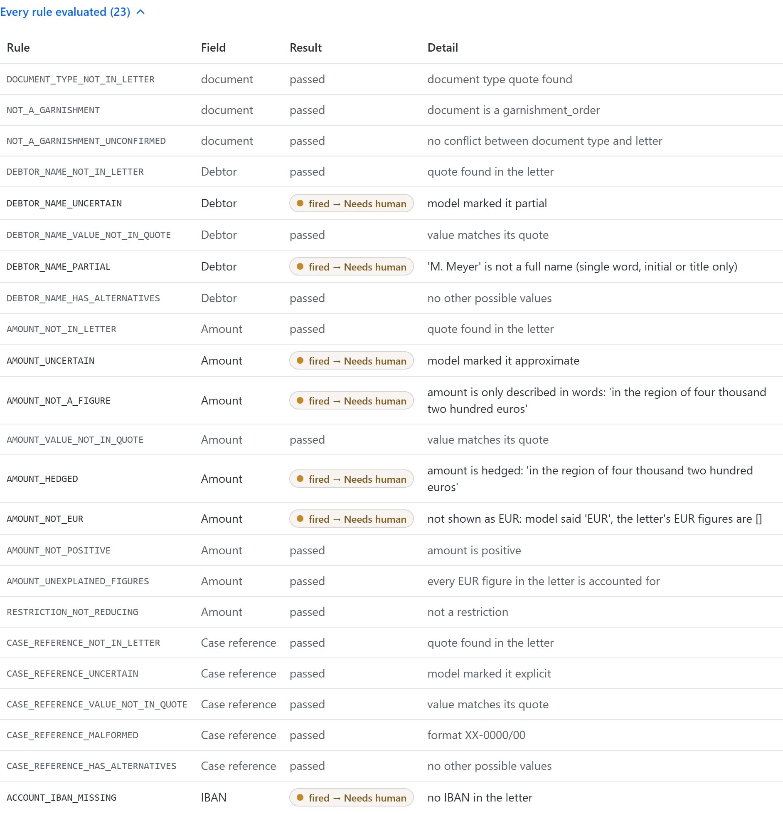

# Porters: garnishment extraction-to-decision

A court letter comes in. An LLM reads it, deterministic rules route it to `auto`, `needs_human` or `reject`,
and the decision is stored with the evidence that produced it. `DESIGN.md` explains why; `NOTES.md` lists
next steps, risks and the decisions still open.


## What a decision card shows

Each letter dropped on the workbench becomes a card. This one is `samples/02-vague-follow-up`, routed to a
person:


- **Header:** the file, when it was decided, which model read it (`recorded:` means a replayed reading in
  demo mode), the rules version, and the route. Click the header to fold the card.
- **Decision path:** letter → model extraction → one lane per field → that field's checks → the route each
  lane forces. The most severe route wins (reject › needs human › auto). Hover a node to see its rules;
  *Replay* reruns the animation.
- **Why:** every rule that fired, with what it found. Here, an initial instead of a full name, an amount
  written only in hedged words, and no IBAN.
- **Extracted fields:** for each field, the value, the confidence the rules gave it (`high`, `low`,
  `invalid`, `absent`), what the model itself said (`explicit`, `approximate`, `partial`...) and the exact
  quote from the letter it came from.
- **Model call:** the model and prompt version, input and output tokens, and the cost, also per 1,000 letters.
  In demo mode no model is called, so these are an estimate, marked ≈.
- **Every rule evaluated:** the full list, passed or fired, so a reviewer can see what was checked and not
  only what failed.
- **Footer:** the decision id and a link to the stored record (`GET /decisions/{id}`).

Opened, *Every rule evaluated* lists all 23 checks run on this letter: the 7 that fired and sent it to a
person, and the 16 that passed, each with its detail.



## Layout

```
backend/app/
  main.py                 app factory: builds engine + LLM client once, mounts routers
  core/config.py          settings from the environment
  core/database.py        engine, ORM base, per-request session
  decisions/              one package per business domain
    router.py             HTTP only: POST /decisions, GET /decisions/{id}
    schema.py             Pydantic: LLM output contract, decision, API request/response
    service.py            use case: extract → decide → record (no HTTP, no SQL)
    rules.py              deterministic routing rules (the hard part, pure functions)
    llm_client.py         the only code that calls a model (Pydantic AI), prompt included
    repository.py         the only code that queries the decisions table
    models.py             SQLAlchemy table
    dependencies.py       wires a service per request
frontend/   Bun + React 19 + shadcn/ui + Tailwind 4: drag-and-drop test workbench
samples/    labelled letters: <nn>-<name>.<expected route>.txt
```

Requests flow one way: `router → service → (llm_client, rules, repository)`. The rules import nothing but the
schemas, so they are tested without a model, a database or HTTP. A new domain gets its own package with the
same files, and `main.py` mounts its router.

## Run it

One command on Windows, Linux or macOS. It installs whatever is missing ([uv](https://docs.astral.sh/uv/),
which brings Python 3.14, and [Bun](https://bun.com)), installs the packages from the lockfiles, and starts
the backend and the frontend. Ctrl+C stops both.

```sh
./start.sh                                           # Linux, macOS
powershell -ExecutionPolicy Bypass -File start.ps1   # Windows
```

Then open http://127.0.0.1:3000 and drop any file from `samples/`. `PORT` (frontend) and `BACKEND_PORT` change
the ports. On a fresh machine, open a new terminal afterwards so `uv` and `bun` are on your `PATH`.

Or by hand, with uv and Bun installed:

```sh
# backend: http://127.0.0.1:8000 (OpenAPI docs at /docs)
cd backend
uv sync
export ANTHROPIC_API_KEY=...        # live mode, optional; PowerShell: $env:ANTHROPIC_API_KEY="..."
uv run uvicorn app.main:create_app --factory --port 8000

# frontend: http://127.0.0.1:3000 (forwards /api/* to the backend)
cd frontend
bun install
bun dev
```

Drop any file from `samples/` onto the page.

### Demo mode and live mode

**Without an API key the app runs in demo mode.** It calls no model: it replays real Haiku 5.5 readings
recorded from a blind run over `samples/` (`backend/recordings/haiku-subagent.json`). These decisions are
labelled `recorded:claude-haiku-5-5`, and their tokens and cost are estimates, marked ≈. A letter with no
recording is stored as `needs_human` / `EXTRACTION_FAILED`, because a letter must never be lost.

**To go live, set `ANTHROPIC_API_KEY` in the terminal you start the app from.** Every letter is then read by
the model, Claude Haiku 5.5 by default:

```powershell
# Windows (PowerShell)
$env:ANTHROPIC_API_KEY = "sk-ant-..."
powershell -ExecutionPolicy Bypass -File start.ps1
```

```sh
# Linux, macOS
export ANTHROPIC_API_KEY="sk-ant-..."
./start.sh
```

- **Check that it is live:** a decision card's *Model call* tiles show `claude-haiku-5-5` from `anthropic`,
  with real token counts and cost and no ≈. Demo decisions say "replayed".
- **Wrong or expired key:** the app still starts, but every letter comes back `needs_human` /
  `EXTRACTION_FAILED`, with the model's error on the card.
- **Where the key lives:** only in that terminal's environment. The app reads no `.env` file and stores the key
  nowhere, so set it again in a new terminal.
- **Cost:** about $0.0004 per letter with Haiku 5.5 (about $0.40 per 1,000 letters). To use Claude Opus 5.5
  instead (about $0.014 per letter), also set `PORTERS_MODEL=anthropic:claude-opus-5-5`.

| Variable | Default | Meaning |
|---|---|---|
| `ANTHROPIC_API_KEY` | (none) | set it to go live (see above); without it, demo mode |
| `PORTERS_EXTRACTOR` | `llm` if a key is set, else `recorded` | force live calls (`llm`) or replay (`recorded`) |
| `PORTERS_RECORDINGS` | `backend/recordings/haiku-subagent.json` | recordings replayed in demo mode |
| `PORTERS_MODEL` | `anthropic:claude-haiku-5-5` | any Pydantic AI model string, e.g. `anthropic:claude-opus-5-5` or another provider (with that provider's key) |
| `PORTERS_DB_URL` | `sqlite:///porters.db` | SQLAlchemy URL of the decision log |
| `API_URL` (frontend) | `http://127.0.0.1:8000` | where the Bun server forwards `/api/*` |

## API

```sh
curl -X POST localhost:8000/decisions -H 'Content-Type: application/json' -d '{"text": "<letter>"}'
curl localhost:8000/decisions/<id>
```

Both return the route, the deciding rule, the reasons, each field's value, confidence, model status and
source quote, every rule evaluated (fired or not), the raw extraction and the model, prompt and rules versions.

## Tests

```sh
cd backend
uv run pytest                                           # rules, API, recorded Haiku readings; no key, ~5 s
PORTERS_LLM_TESTS=1 uv run pytest tests/test_samples_llm.py  # real model over every labelled sample; needs ANTHROPIC_API_KEY, <1¢
uv run ruff check && uv run ruff format --check && uv run ty check  # lint (all ruff rules), format, types
cd ../frontend && bun run typecheck
```

CI (`.github/workflows/ci.yml`) runs ruff, ty and pytest on every pull request and every push to `main`.
