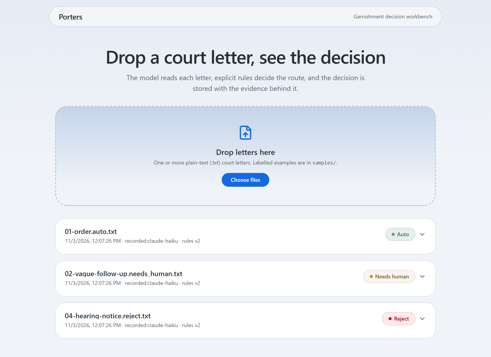
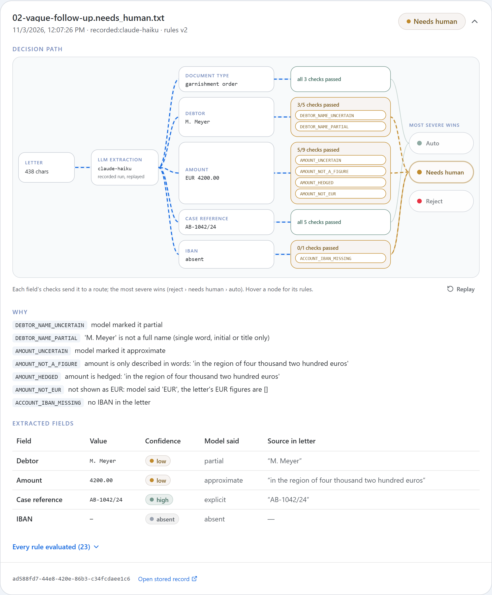

# Porters: garnishment extraction-to-decision

A court letter comes in. An LLM reads it, deterministic rules route it to `auto`, `needs_human` or `reject`,
and the decision is stored with the evidence that produced it. `DESIGN.md` explains why; `NOTES.md` lists
next steps, risks and the decisions still open.



## What a decision card shows

Each letter dropped on the workbench becomes a card. This one is `samples/02-vague-follow-up`, routed to a
person:



- **Header:** the file, when it was decided, which model read it (`recorded:` means a replayed reading in
  demo mode), the rules version, and the route. Click the header to fold the card.
- **Decision path:** letter → model extraction → one lane per field → that field's checks → the route each
  lane forces. The most severe route wins (reject › needs human › auto). Hover a node to see its rules;
  *Replay* reruns the animation.
- **Why:** every rule that fired, with what it found. Here, an initial instead of a full name, an amount
  written only in hedged words, and no IBAN.
- **Extracted fields:** for each field, the value, the confidence the rules gave it (`high`, `low`,
  `invalid`, `absent`), what the model itself said (`explicit`, `approximate`, `partial`...) and the exact
  quote from the letter it came from.
- **Every rule evaluated:** the full list, passed or fired, so a reviewer can see what was checked and not
  only what failed.
- **Footer:** the decision id and a link to the stored record (`GET /decisions/{id}`).

## Layout

```
backend/app/
  main.py                 app factory: builds engine + LLM client once, mounts routers
  core/config.py          settings from the environment
  core/database.py        engine, ORM base, per-request session
  decisions/              one package per business domain
    router.py             HTTP only: POST /decisions, GET /decisions/{id}
    schema.py             Pydantic: LLM output contract, decision, API request/response
    service.py            use case: extract → decide → record (no HTTP, no SQL)
    rules.py              deterministic routing rules (the hard part, pure functions)
    llm_client.py         the only code that calls a model (Pydantic AI), prompt included
    repository.py         the only code that queries the decisions table
    models.py             SQLAlchemy table
    dependencies.py       wires a service per request
frontend/   Bun + React 19 + shadcn/ui + Tailwind 4: drag-and-drop test workbench
samples/    labelled letters: <nn>-<name>.<expected route>.txt
```

Requests flow one way: `router → service → (llm_client, rules, repository)`. The rules import nothing but the
schemas, so they are tested without a model, a database or HTTP. A new domain gets its own package with the
same files, and `main.py` mounts its router.

## Run it

Needs [uv](https://docs.astral.sh/uv/) and [Bun](https://bun.com).

```sh
# backend: http://127.0.0.1:8000 (OpenAPI docs at /docs)
cd backend
uv sync
export ANTHROPIC_API_KEY=...        # PowerShell: $env:ANTHROPIC_API_KEY="..."
uv run uvicorn app.main:create_app --factory --port 8000

# frontend: http://localhost:3000 (forwards /api/* to the backend)
cd frontend
bun install
bun dev
```

Drop any file from `samples/` onto the page.

**Without an API key the app runs in demo mode.** Instead of calling the model, it replays real Haiku readings
recorded from a blind run over `samples/` (`backend/recordings/haiku-subagent.json`). Every decision made this
way is labelled `recorded:claude-haiku`. A letter with no recording is stored as `needs_human` /
`EXTRACTION_FAILED`, because a letter must never be lost. With a key set, every letter is a live model call.

| Variable | Default | Meaning |
|---|---|---|
| `ANTHROPIC_API_KEY` | (none) | credentials for the default model |
| `PORTERS_EXTRACTOR` | `llm` if a key is set, else `recorded` | force live calls (`llm`) or replay (`recorded`) |
| `PORTERS_RECORDINGS` | `backend/recordings/haiku-subagent.json` | recordings replayed in demo mode |
| `PORTERS_MODEL` | `anthropic:claude-opus-5-5` | any Pydantic AI model string, e.g. another provider |
| `PORTERS_DB_URL` | `sqlite:///porters.db` | SQLAlchemy URL of the decision log |
| `API_URL` (frontend) | `http://127.0.0.1:8000` | where the Bun server forwards `/api/*` |

## API

```sh
curl -X POST localhost:8000/decisions -H 'Content-Type: application/json' -d '{"text": "<letter>"}'
curl localhost:8000/decisions/<id>
```

Both return the route, the deciding rule, the reasons, each field's value, confidence, model status and
source quote, every rule evaluated (fired or not), the raw extraction and the model, prompt and rules versions.

## Tests

```sh
cd backend
uv run pytest                                           # rules, API, recorded Haiku readings; no key, ~5 s
PORTERS_LLM_TESTS=1 uv run pytest tests/test_samples_llm.py  # real model over every labelled sample (costs money)
uv run ruff check && uv run ruff format --check && uv run ty check  # lint (all ruff rules), format, types
cd ../frontend && bun run typecheck
```

CI (`.github/workflows/ci.yml`) runs ruff, ty and pytest on every pull request and every push to `main`.
